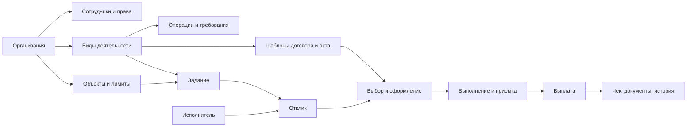

# WinWork: роли, сущности, пользовательские процессы и презентации

Срез: 20 сентября 2026 года. Документ соединяет описание продукта из `[N-02, N-03, N-04]` с фактически просмотренными четырьмя презентациями и десятью локальными демо `[P-*]`. Это карта предметной области для портфолио; она не является схемой производственной базы данных или исчерпывающей спецификацией статусов.

## 1. Роли и ответственность

| Роль                                     | Основная задача                                   | Что важно в интерфейсе                                                                           |
| ---------------------------------------- | ------------------------------------------------- | ------------------------------------------------------------------------------------------------ |
| Руководитель / администратор заказчика   | Настроить правила работы организации              | Компании, объекты, виды деятельности, сотрудники, права, ставки, лимиты                          |
| Руководитель объекта                     | Обеспечить выполнение локальных заданий           | Разрешенные объекты и работы, остаток лимитов, отклики, коммуникация, приемка и оплата           |
| Бухгалтер / финансовый сотрудник         | Контролировать расчеты и документы                | Реестры, статусы выплат, договоры, акты, чеки, отчеты                                            |
| HR / сотрудник по работе с исполнителями | Подключать и отбирать людей                       | Пул, анкеты, сведения о кандидатах, предложения трудоустройства; полномочия зависят от настройки |
| Служба контроля                          | Следить за применением правил                     | Проверки, ограничения, история, документы и причины остановки операции                           |
| Исполнитель                              | Найти и выполнить работу, получить вознаграждение | Регистрация, допуск, условия задания, отклик, документы, статусы и платежные данные              |
| Интеграционная команда клиента           | Соединить внутренний процесс с WinWork            | Данные, команды, статусы, проверки, тестирование и пилот                                         |
| Представитель продаж WinWork             | Объяснить ценность и показать сценарий            | Презентация с подходящим акцентом, удобные переходы в демо и возврат к рассказу                  |
| Зритель судебной презентации             | Понять доступность сервиса и действия сторон      | Последовательный показ регистрации, отклика, выбора, оплаты и статистики                         |

Роль не равна жестко заданному комплекту прав. В источниках встречаются клиентские конфигурации, где один и тот же HR-пользователь имеет разные возможности подписи. Права оплаты, подписи документов и просмотра следует рассматривать раздельно.

## 2. Словарь и связи сущностей

| Понятие                    | Значение в данном контексте                                                                                       |
| -------------------------- | ----------------------------------------------------------------------------------------------------------------- |
| Заказчик                   | Организация, которая размещает задания или использует инфраструктуру выплат/документов                            |
| Сотрудник заказчика        | Внутренний пользователь кабинета с выданными полномочиями                                                         |
| Исполнитель                | Человек или ИП, выполняющий работу; это не синоним сотрудника заказчика                                           |
| Объект                     | Магазин, склад или иная операционная единица с адресом, руководителями и настройками заданий                      |
| Проект                     | Уровень организации работы/баланса в кабинете; точное отличие от объекта менялось или не полностью раскрыто       |
| Вид деятельности           | Тип работы с требованиями, операциями и шаблонами документов                                                      |
| Операция                   | Конкретное действие внутри работы с длительностью и описанием для документов                                      |
| Задание / заказ            | Опубликованные условия работы, потребность в одном или нескольких исполнителях                                    |
| Отклик                     | Выраженная исполнителем заинтересованность; не равен назначению или выполнению                                    |
| Предпочитаемый исполнитель | Человек из пула заказчика с приоритетным приглашением и описанным автоматическим приемом отклика                  |
| Вакансия                   | Предложение трудоустройства; отличается от разового задания                                                       |
| Реестр                     | Структурированный пакет записей; отдельно существуют реестры объектов, исполнителей, заданий, документов и выплат |
| НПД / СМЗ                  | Налог на профессиональный доход / самозанятый в терминологии материалов                                           |
| ИП на НПД                  | Индивидуальный предприниматель, применяющий НПД; не отдельная организационная форма от ИП                         |
| ГПХ                        | Гражданско-правовой формат договора; не налоговый статус                                                          |
| ЭДО                        | Электронный документооборот: подготовка, подпись, состояния и хранение документов                                 |
| GMV                        | Объем проведенных через соответствующий продукт выплат; не доход WinWork                                          |
| OTP                        | Одноразовый код подтверждения; формат и назначение зависят от конкретного процесса                                |

Концептуальная связь сущностей:

Проверки и ограничения пересекают этот процесс в нескольких точках. Конкретная стадия проверки зависит от сценария: допуск к отклику, назначение, подписание или выплата.

## 3. Сквозные процессы продукта

### A. Подключение корпоративного заказчика и делегирование

1. Представитель регистрирует компанию, подтверждает контакты и проходит необходимые действия подключения.
2. Администратор определяет допустимые категории исполнителей и виды деятельности.
3. Для видов деятельности выбираются документы, требования и операции.
4. Создаются объекты с адресами, ставками и лимитами; для сети возможен импорт.
5. Назначаются сотрудники и руководители, оформляются полномочия.
6. Руководители работают с заданиями через мобильный или веб-интерфейс в заданных границах.
7. Центральные функции получают сведения о выплатах, документах и истории.

Главная зависимость: удобство ежедневной публикации обеспечивается качеством предварительных настроек. Источники: `[N-03; P-ENT: ent-03…ent-09, ent-16]`.

### B. Заказчик: от потребности до закрытия работы

1. Выбрать объект, вид работы и разрешенные операции.
2. Указать время, объем и количество людей, проверить стоимость.
3. Опубликовать задание вручную или через реестр.
4. Получить отклики из открытого маркетплейса и/или пригласить свой пул.
5. Сравнить кандидатов и выбрать исполнителя; для предпочитаемого возможна отдельная автоматизация.
6. Оформить документы и подтверждения, необходимые для начала работы.
7. Следить за исполнением; при необходимости общаться в чате.
8. Получить сообщение о завершении, проверить результат, согласовать изменения при наличии.
9. Подтвердить оплату; получить платежный статус и документы.
10. Использовать историю и выгрузки для учета и повторной работы.

Это смысловая модель. Она не утверждает, что договор всегда подписывается строго после выбора или что любая ошибка автоматически разрешается. Источники: `[N-03; P-SMB: smb-04; P-COURT: court-02…court-05]`.

### C. Исполнитель: от знакомства до вознаграждения

Человек приходит из магазина приложений, по ссылке на задание или приглашению компании. После подтверждения телефона он знакомится с предложениями, выбирает формат работы и дополняет профиль. Для НПД предусмотрено подключение WinWork как партнера в «Моем налоге». Необходимые документы и реквизиты определяют готовность к дальнейшим действиям.

Далее исполнитель изучает задание, откликается и ждет решения. После назначения и оформления он выполняет работу, сообщает о завершении, при необходимости согласует изменения и получает выплату. Сервис сохраняет связанные документы и статусы. Возможность раннего отклика не означает, что вся идентификация или платежные настройки уже завершены. `[N-02, N-03, N-04; P-FLOW]`

### D. Перенос своего пула

Заказчик выбирает способ подключения: ИНН для уже известного пользователя, реестр, SMS или персонализированная ссылка. Человек предоставляет недостающие сведения и согласия; его связь с заказчиком фиксируется в базе. Затем заказчик может пригласить его на общедоступное задание как предпочитаемого исполнителя. Это путь снижения барьера перехода, а не создание закрытого задания, недоступного всем остальным. `[N-03; P-ENT: ent-10]`

### E. API-клиент

Команды сначала определяют, какие процессы остаются у клиента, какие выполняет WinWork, как сопоставляются данные и статусы. Исполнитель проходит необходимую веб-регистрацию. Основные действия могут начинаться в системе клиента; WinWork выполняет согласованные проверки, работу с документами и выплатами, возвращает результаты. После тестирования идет пилот и расширение охвата. Транспорт обмена и подробная обработка ошибок из презентации не устанавливаются. `[P-API: api-02, api-05, api-06, api-12, api-15]`

### F. Исторические выплаты через реестр

В старом/отдельном сценарии компания формировала выплату по исполнителю и услуге без публикации задания. Это важно для понимания происхождения продукта. Февральский отчет 2026 года сообщает о переводе выплат СМЗ в модель заданий; API и White Label тогда еще имеют собственный план перехода. Поэтому нельзя рисовать один неизменный путь реестров для всех периодов. `[N-03, N-04/N-08]`

## 4. Как устроены демонстрации

В текущем проекте просмотрены все **43 слайда** и основные пути всех **10 уникальных демо**. Демонстрации открываются поверх слайда, имеют возврат/закрытие и сброс состояния. Повторное использование одного демо в нескольких презентациях не создает новую функцию продукта.

Прототипы используют локальные данные и состояния. Часть второстепенных кнопок, меню и разделов нужна для контекста экрана и не ведет в полный промышленный сценарий. Регистрация исполнителя намеренно выполнена как линейная последовательность: клик по экрану переводит на следующий шаг. Все ограничения ниже относятся к демо, а не автоматически к производственному WinWork.

### D01. Регистрация юридического лица — `registration`

**Вход:** `court-02`, также быстрый доступ на главной странице проекта.

**Путь:** экран входа → регистрация → компания/ИНН, должность, телефон, email, пароль → сообщение о письме → условное подтверждение письма → вход → приветствие в кабинете.

Поля демонстрации могут подставлять подготовленные значения при фокусе/клике. Кнопка завершения регистрации зависит от заполнения полей. Вход по логину и AD виден как контекст, но основной путь проверен по телефону. Письма не отправляются, реальная компания и учетная запись не создаются. Источник реализации: `RegistrationDemo.tsx`.

### D02. Создание объекта — `create-object`

**Вход:** `ent-04`, быстрый доступ.

**Путь:** список объектов → добавление → адрес и идентификатор → руководитель → виды деятельности → ставка и ограничения → сохранение → новая строка/подтверждение.

В сценарии есть различие между существующим руководителем и приглашением нового, выбор нескольких разрешенных работ, включение лимитов и проверки обязательных значений. Можно увидеть назначение доверенности. Полная загрузка Excel, отправка приглашения и хранение реального документа отсутствуют. Дополнительные ограничения полей и формулы в демо не следует считать промышленными правилами продукта. Источник: `DesktopDemos.tsx`.

### D03. Работа руководителя с телефона — `manager-app`

**Вход:** `ent-05`, быстрый доступ.

**Основные ветки:** вход → список заданий; создание задания с объектом/видом деятельности/операциями/временем/числом людей; работа с откликом и выбор исполнителя; просмотр задачи и профиля; список чатов и переписка; выполненное задание → оплата → OTP → подтверждение; настройки уведомлений.

Показаны вкладки стадий, календарь, лимиты и управление на месте. При просмотре пройдены создание, выбор отклика, чат, подтверждение оплаты и настройки уведомлений. Некоторые значения и переходы упрощены: примерные суммы или кандидат в разных состояниях не всегда составляют полностью согласованный набор. Это не финансовые данные и не дефект, автоматически приписываемый реальному продукту. Источник: `ManagerAppDemo.tsx`.

### D04. Создание вида деятельности — `create-activity`

**Вход:** `ent-07`, быстрый доступ.

**Путь:** раздел пакетов документов/видов деятельности → добавить → выбрать работу → договор и акт → текстовые требования → медкнижка/права → операции → новая операция с названием, длительностью и описанием → сохранить.

Демо показывает взаимосвязь будущего задания и его документации. Успешное сохранение подтверждается локальным сообщением; это не полноценный справочник с серверной персистентностью и проверкой документов исполнителя. Источник: `DesktopDemos.tsx`.

### D05. Шаблоны договора и акта — `document-templates`

**Вход:** `ent-08`, быстрый доступ.

**Путь:** настройка вида деятельности → выбор шаблона договора → создание нового → название, текст, переменные и форматирование → сохранить и выбрать → аналогичная работа с актом → возврат в настройку.

При просмотре проверены создание договора, вставка переменной, сохранение выбора и редактор акта. Пункт перехода в документооборот в рамках демо открывает нужный локальный редактор. Реальная подпись, генерация юридически значимого комплекта и весь архив здесь не воспроизводятся. Источник: `DesktopDemos.tsx`.

### D06. Публикация одиночного/группового задания — `single-task`

**Вход:** `ent-09`, `smb-06`, `court-02`, быстрый доступ.

**Путь:** маркетплейс → «Разместить задание» → «Разовое задание» → объект и вид деятельности → время, операции и число исполнителей → итоговая сумма → создать → экран успешного создания.

Ставка наследуется и не редактируется в обычном поле задания. При просмотре изменено число исполнителей и получено подтверждение создания групповой потребности. После успеха видны готовность/копирование/другие действия. Вариант реестра и переключатель регулярности не превращают этот демо-путь в полноценный импорт или планировщик повторений. Источник: `DesktopDemos.tsx`.

### D07. Регистрация исполнителя — `performer-registration`

**Вход:** `court-03`, быстрый доступ.

Проверены все 11 состояний:

1. Начальный экран входа с телефоном.
2. Телефон заполнен.
3. Подтверждение кодом.
4. Маркетплейс с предложением завершить регистрацию.
5. Выбор гражданства.
6. Выбор формата работы и объяснение подключения самозанятого.
7. Подключение партнера по телефону или ИНН.
8. Инструкция по разрешению партнерства в «Моем налоге».
9. Экран загрузки «Мой налог».
10. Личные данные, паспорт, адрес и действие сканирования.
11. Возврат в маркетплейс с сообщением об успешной регистрации и предложением добавить реквизиты.

Экраны воссозданы компонентами по состояниям Figma; только согласованный экран загрузки внешнего приложения использует полноэкранное изображение. Клик по поверхности продвигает последовательность, ввод реального телефона/паспорта и внешняя авторизация не нужны. Высокий контент прокручивается; при новом шаге прокрутка сбрасывается. Ветки всех стран, налоговых категорий, ошибок и добавления реквизитов не реализованы. Источник: `PerformerRegistrationDemo.tsx`.

### D08. Отклик исполнителя — `performer-response`

**Вход:** `court-03`, быстрый доступ.

**Три состояния:** маркетплейс → конкретное задание → отклик «На рассмотрении». При первом нажатии открываются условия; при следующем отправляется отклик. На итоговом экране видны статус и контекст общения/отмены. Предусмотрен возврат и сброс.

Рабочим сделан целевой сценарий одного задания; остальные карточки задают окружение. Карта, фильтры и все второстепенные действия не составляют отдельные полные флоу. Это уже смысловые действия «открыть» и «откликнуться», в отличие от линейного переключения всех регистрационных экранов. Источник: `PerformerResponseDemo.tsx`.

### D09. Выбор исполнителей — `performer-selection`

**Вход:** `court-04`, быстрый доступ.

**Путь:** список заданий → целевое задание с откликами → боковая панель → три карточки кандидатов → отзывы → возврат → принять/отказать.

При просмотре открыты отзывы, принят один отклик и отклонен другой. В карточках есть рейтинг, сведения о выполнении, статус, доход/лимиты и связь с человеком. Решение меняет локальное состояние кнопок; полный путь от назначения до выполнения в этом демо не воспроизводится. Не все показанные проценты согласованы с числом выполненных заданий, поэтому по ним нельзя выводить формулу надежности. Источник: `PerformerSelectionDemo.tsx`.

### D10. Оплата выполненного задания — `task-payment`

**Вход:** `court-05`, быстрый доступ.

**Путь:** список → выполненное задание → вкладка действий → название, сумма и дополнительная информация → «Подтвердить и оплатить» → четырехзначный демонстрационный SMS-код → «Оплатить» → статус «Оплачен», действие «Отправлено» → запись в истории.

Есть соседние вкладки задания, исполнителя, документов и истории. При просмотре проверены успешная оплата и появление события, а в документах — наличие действия скачивания. Демо не переводит деньги, не отправляет SMS, не исполняет налоговое поручение и не доказывает получение действительного чека. Источник: `TaskPaymentDemo.tsx`.

## 5. Карта четырех презентаций: все 43 слайда

Ниже перечислены смысловые темы в фактическом порядке показа. ID сохранены как идентификаторы источников, поэтому нумерация может иметь пропуски. Краткие формулировки — описание содержания, а не дословные заголовки.

### Enterprise — 17 слайдов, `/enterprise`

| №   | ID     | Содержание и роль в рассказе                                              | Демо |
| --- | ------ | ------------------------------------------------------------------------- | ---- |
| 1   | ent-01 | Единый процесс работы с исполнителями, объектами, документами и выплатами | —    |
| 2   | ent-02 | Почему сеть объектов усложняет управление                                 | —    |
| 3   | ent-03 | Центральный офис задает правила, объекты работают в их пределах           | —    |
| 4   | ent-04 | Предварительная настройка объектов и массовая загрузка                    | D02  |
| 5   | ent-05 | Мобильная работа руководителя объекта                                     | D03  |
| 6   | ent-06 | Права сотрудников и доверенность                                          | —    |
| 7   | ent-07 | Виды деятельности, требования, операции и документы                       | D04  |
| 8   | ent-08 | Шаблоны договоров и актов, подстановка данных                             | D05  |
| 9   | ent-09 | Единичное задание и массовая публикация через реестр                      | D06  |
| 10  | ent-10 | Открытый маркетплейс и существующий пул в одном процессе                  | —    |
| 11  | ent-11 | Ссылки, QR, рефералы и дополнительные каналы привлечения                  | —    |
| 12  | ent-12 | Надежность, ограничения и опыт при допуске/выборе                         | —    |
| 13  | ent-13 | Проверки перед допуском и выплатой, обмен с системой клиента              | —    |
| 14  | ent-18 | Нерезиденты, сроки и подготовка PDF для самостоятельной подачи в МВД      | —    |
| 15  | ent-14 | Ограничения сотрудничества и приглашение в штат                           | —    |
| 16  | ent-16 | Данные для финансов, HR, контроля и поддержка                             | —    |
| 17  | ent-17 | Подключение компании и начало работы                                      | —    |

Логика: масштаб проблемы → распределение ответственности → настройки → ежедневная работа → расширение пула → контроль → подключение. Пять демонстраций раскрывают операционные механизмы. Сценарий `ent-18` действительно стоит после `ent-13`; отсутствующий `ent-15` не считается слайдом.

### Малый бизнес — 12 слайдов, `/small`

| №   | ID     | Содержание и роль в рассказе                              | Демо |
| --- | ------ | --------------------------------------------------------- | ---- |
| 1   | smb-01 | Единый процесс от задания до выплаты                      | —    |
| 2   | smb-02 | Административная нагрузка даже при небольшой базе         | —    |
| 3   | smb-03 | Настроить основные параметры один раз                     | —    |
| 4   | smb-04 | Семь шагов полного цикла                                  | —    |
| 5   | smb-05 | Свои исполнители и новый поиск                            | —    |
| 6   | smb-06 | Выбор параметров, детали, публикация задания              | D06  |
| 7   | smb-07 | Отклики, профиль, надежность, групповой выбор             | —    |
| 8   | smb-08 | Самостоятельные действия исполнителя                      | —    |
| 9   | smb-09 | Договор и акт из шаблонов                                 | —    |
| 10  | smb-10 | Приемка, согласование изменений и выплата                 | —    |
| 11  | smb-11 | Документы и история в карточке задания                    | —    |
| 12  | smb-12 | Регистрация, пополнение, идентификация и помощь на старте | —    |

Логика: показать понятный повседневный цикл и объем ручной работы, который берет на себя сервис. Главное интерактивное доказательство — создание задания. Налоговые формулировки слайда 10 нужно читать с условиями конкретной категории; для НПД судебная версия явно указывает поручение и разрешение исполнителя.

### API — 8 слайдов, `/api`

| №   | ID     | Содержание и роль в рассказе                                       | Демо |
| --- | ------ | ------------------------------------------------------------------ | ---- |
| 1   | api-01 | WinWork как инфраструктура внутри продукта клиента                 | —    |
| 2   | api-02 | Разделение функций: интерфейс клиента и операции WinWork           | —    |
| 3   | api-04 | Снижение числа отдельных интерфейсов и ручных сверок               | —    |
| 4   | api-05 | Веб-регистрация исполнителя и продолжение работы у клиента         | —    |
| 5   | api-06 | Проверки в момент решения или выплаты                              | —    |
| 6   | api-12 | Возврат статусов, документов, истории и учетных данных             | —    |
| 7   | api-15 | Границы интеграции, данные, правила, тест, пилот и масштабирование | —    |
| 8   | api-17 | Подключение и передача материалов разработчикам                    | —    |

Здесь нет интерактивных продуктовых демо. Основное средство объяснения — схемы разделения ответственности. Слайды не полностью одинаково формулируют степень встраивания: `api-02` допускает контакт с приложением или вебом WinWork, а `api-05` конкретизирует обязательную веб-регистрацию. Корректный вывод — согласуемая интеграция, а не обещание полностью невидимого сервиса.

### Судебная / открытая — 6 слайдов, `/court`

| №   | ID       | Содержание и роль в рассказе                         | Демо     |
| --- | -------- | ---------------------------------------------------- | -------- |
| 1   | court-01 | Двусторонний сервис и оператор из перечня ФНС        | —        |
| 2   | court-02 | Открытая регистрация заказчика и публикация          | D01, D06 |
| 3   | court-03 | Доступ исполнителя, регистрация и отклик             | D07, D08 |
| 4   | court-04 | Самостоятельный выбор заказчиком из откликов         | D09      |
| 5   | court-05 | Подтверждение оплаты, документы и условие уплаты НПД | D10      |
| 6   | court-06 | База участников, активность и финансовые показатели  | —        |

Логика: объяснить платформу через наблюдаемые действия обеих сторон. Назначение для суда известно из рассказа автора; факт использования на конкретном заседании и правовой результат не сообщены. Есть упаковка той же презентации в один автономный HTML без установки приложения/сервера; это вариант доставки, а не пятая презентация.

## 6. Итог анализа флоу для будущих кейсов

**Преднастройка уменьшает сложность ежедневного действия.** Объект, вид деятельности и шаблон документа становятся входными данными создания задания. Кейс публикации лучше объяснять вместе с этими зависимостями.

**Два мобильных приложения обслуживают разные стороны.** Руководитель действует от имени заказчика в рамках бюджета и полномочий. Исполнитель выбирает работу, выражает согласие и выполняет ее. Смешение ролей делает описание продукта неточным.

**Состояние управляет доступностью действия.** «Отклик на рассмотрении», «назначен», «выполнен» и «оплачен» означают разные обязательства и следующие шаги. В кейсах полезно показывать переходы и инициатора каждого перехода.

**Демонстрационный путь намеренно ограничен.** Предсказуемые данные, сброс и выделенные основные действия помогают ведущему показывать смысл. Это качество инструмента демонстрации; оно не заменяет требования к полноте реального продукта.

**Сегментация меняет объяснение ценности.** Enterprise раскрывает управление системой, Small — ежедневный процесс, API — границы интеграции, Court — действия сторон и устройство площадки. Общие сущности сохраняются, но доказательство пользы выбирается под задачу аудитории.
