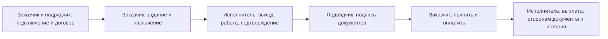

# Подрядная схема WinWork

## Что это и зачем нужно

Подрядная схема добавляет к обычной работе заказчика с исполнителем третью сторону — подрядчика. Заказчик продолжает управлять заданием, выбором исполнителя, приёмкой и моментом оплаты. Подрядчик заключает договор с исполнителем и подписывает документы. По пояснению пользователя выплата исполнителю идёт от юридического лица подрядчика, а заказчик получает акт от подрядчика. Это описание показанного сценария, не самостоятельная юридическая оценка модели.

| Роль        | Ответственность в показанном процессе                                                                                                                          |
| ----------- | -------------------------------------------------------------------------------------------------------------------------------------------------------------- |
| Заказчик    | Подключает подрядчика, публикует задание через него, назначает исполнителя, принимает и оплачивает                                                             |
| Подрядчик   | Подключает режим работы с клиентами, оформляет договорные отношения, видит задания клиентов и подписывает документы; не заменяет заказчика в решении об оплате |
| Исполнитель | Откликается, подтверждает выход, выполняет работу, первым подтверждает выполнение и затем получает выплату                                                     |

Для заказчика главное — сохранить привычное управление заданиями и деньгами: при создании выбирается подрядчик, руководители действуют в пределах настроенных лимитов объекта. Подрядчик в своём кабинете называет заказчика **клиентом**. Это та же сторона процесса, а не четвёртая роль.

Полный прототип создан для объяснения нового функционала с трёх сторон на одном компьютере. Сценарий листается общей панелью, активная роль выделена цветом. Краткая версия появилась после обратной связи руководства: вместо подробного flow нужно быстро показать суть — подключить подрядчика, создать задание, принять и оплатить. Источники и поздние исправления порядка действий — в [реестре контекста](winwork/sources.md).

Отчёты развивают эту тему: заказчику нужна выборка по подрядчикам, подрядчику — по клиентам. Это отдельный функциональный прототип, описанный в [reports.md](reports.md); в пять презентационных редакций он не входит.

## Редакции и сборка

Автономная презентация по [макету Pencil](../pencil/outsource_shchema.pen) и прототип по [макету Figma](https://www.figma.com/design/WwZNRrCGSRZK1OwtXHI7WQ?node-id=13-3800). Команда `pnpm build:contracting:offline` собирает пять самостоятельных HTML в `dist/offline/`. Каждый файл открывается в Google Chrome напрямую, без сервера и сети.

| Вариант          | Файл                                                                    | Содержание                                                |
| ---------------- | ----------------------------------------------------------------------- | --------------------------------------------------------- |
| `full`           | `Открыть подрядную схему WinWork.html`                                  | 5 слайдов и 15 этапов, 35 экранов всех трёх ролей         |
| `prototype`      | `Открыть демо подрядной схемы WinWork.html`                             | Сразу 15 этапов и 35 экранов всех трёх ролей              |
| `customer`       | `Открыть подрядную схему WinWork — для заказчика.html`                  | 5 слайдов, 10 этапов и 25 экранов заказчика и исполнителя |
| `customer-brief` | `Открыть подрядную схему WinWork — для заказчика (краткая версия).html` | 10 статичных слайдов из Pencil                            |
| `contractor`     | `Открыть подрядную схему WinWork — для подрядчика.html`                 | 5 слайдов, 9 этапов и 19 экранов подрядчика и исполнителя |

Передайте идентификаторы вариантов, чтобы собрать только нужные файлы. Например, `pnpm build:contracting:offline prototype customer contractor` собирает три дополнительных версии.

## Краткая версия для заказчика

Команда `pnpm build:contracting:offline customer-brief` собирает десять слайдов из [макета Pencil](../pencil/outsource_shchema.pen). После четырёх вводных слайдов идут обзор трёх шагов, подключение подрядчика, создание задания, приёмка и оплата, лимиты по объектам и итог про управление выплатами. Панель, переходы, полноэкранный режим и история общие с остальными вариантами. Прямые ссылки сохраняют прежние идентификаторы сцен, в том числе `ctr-brief-limits` для девятого слайда.

`src/contracting/customerBriefSlides.ts` сопоставляет сцены с фреймами Pencil и задаёт порядок. Экспортируйте каждый обновлённый фрейм как HTML/CSS с идентификаторами слоёв в `src/assets/contracting/customer-brief/`. Сохраните имена файлов и семантику заголовков и изображений. Уберите ссылки на Google Fonts и укажите локальные пути изображений. Сборка встраивает Inter и изображения, включая фоновые заливки с кадрированием из Pencil. Исходные скриншоты веб-кабинета из [макета Figma](https://www.figma.com/design/WwZNRrCGSRZK1OwtXHI7WQ?node-id=33-2185) берутся из `figma-brief/`, а изображения для мобильных экранов и итогового слайда — из `customer-brief/images/`.

## Порядок показа в полной версии

- Слайды `ctr-01`–`ctr-05` объясняют назначение схемы, договорные связи и путь задания до выплаты. «Показать в WinWork» на пятом слайде, стрелка вправо и кнопка «Следующая сцена» ведут на первый экран прототипа. Кнопка «Предыдущая сцена» с этого экрана возвращает к пятому слайду.
- Этапы 1–4: заказчик подключает подрядчиков и отправляет предложение, подрядчик подключает режим работы с клиентами и подписывает договор. Обе стороны видят, что договор подписан.
- Этапы 5–9: заказчик публикует задание через подрядчика, исполнитель откликается, заказчик его назначает, исполнитель подтверждает выход. Подрядчик просматривает задания клиентов и отклики.
- Этапы 10–12: исполнитель первым подтверждает выполнение и видит статус «На подтверждении». Заказчик видит, что нужна подпись подрядчика. Подрядчик подписывает задание и акт выполненных работ.
- Этап 13: заказчик нажимает «Принять и оплатить», подтверждает оплату кодом из СМС и видит один подписанный документ «Задание и акт выполненных работ».
- Этапы 14–15: исполнитель видит выплату в процессе и завершение задания. Подрядчик видит три подписанных документа: договор об оказании услуг, задание и акт с исполнителем и акт с заказчиком.

В версии `prototype` открывается сразу первый экран, «Подключение подрядчиков». В ролевых версиях кнопка «Показать в WinWork» ведёт в кабинет заказчика или подрядчика. В обеих версиях показано приложение исполнителя от отклика до выплаты. В версии для подрядчика подпись к списку «Задания клиентов» поясняет, что задание появляется в кабинете после публикации заказчиком. Номера этапов считаются по текущей версии.

## Реализация и проверка

- `src/contracting/introSlides.ts` задаёт порядок слайдов и идентификаторы фреймов Pencil. Экспортируйте обновлённый кадр как HTML/CSS с идентификаторами слоёв в `src/assets/contracting/slides/` и удалите ссылки на внешний шрифт. На слое кнопки `GZN3d` в `ctr-05.html` сохраните атрибут `data-presentation-next`. Общий рендерер измеряет его границы после загрузки шрифта. `scripts/package-offline-contracting.mjs` подставляет тексты обложки и перехода к демо для каждой роли по идентификаторам слоёв.
- `src/contracting/scenario.tsx` собирает этапы выбранных ролей в порядке `order`. Список в панели открывает первый экран выбранного этапа. Хеш хранит конкретный экран, поэтому история браузера сохраняет роль, открытый раздел и панель. Ссылка на сцену вне выбранного варианта возвращает к его первому экрану.
- Активная роль выделена цветом. В ролевых версиях показаны две плашки, в полной и в `prototype` — три. Название и описание шага находятся в белой карточке над экраном, номер этапа расположен справа.
- Имена, компании и реквизиты вымышлены. Основное задание и компании используют общие данные в `src/contracting/fixtures.ts`. В фоновых строках маркетплейса — прямые задания заказчика, а в таблице подрядчика — отдельные заказы его действующих клиентов.
- Настольные экраны используют общие компоненты WinWork. Левая навигация раскрывает группы, не меняя сценарий. Панель справа затемняет область продукта. На экранах с действием обводка показывает нужную кнопку, вкладку или строку. При настройке уменьшенного движения обводка статична.
- Панель WinWork со стрелками, выбором сцены, сбросом к началу и полноэкранным режимом видна постоянно. Сборка встраивает шрифты, графику и слайды выбранного варианта. После сборки всех файлов запустите `pnpm test:contracting`. Тесты проверяют переходы, порядок действий, документы, набор этапов и прямые ссылки без сети. В краткой версии они проверяют десять фреймов в порядке показа, историю, выбор сцены, исходные изображения и возврат к обложке.

## Отчёты по подрядной схеме

`pnpm build:contracting:reports` собирает отдельный файл `dist/offline/Отчёты — подрядная схема WinWork.html`. У заказчика отчёты по подрядчикам, у подрядчика — по клиентам. Есть реестр заданий, сводка компаний, выбор периода/статусов, локальное формирование, просмотр и XLSX.

Полная постановка, правила данных, карта реализации и границы будущего продукта — в [reports.md](reports.md). Отчёт не входит в пять презентационных редакций и требует отдельной проверки `pnpm test:contracting:reports` после сборки.
