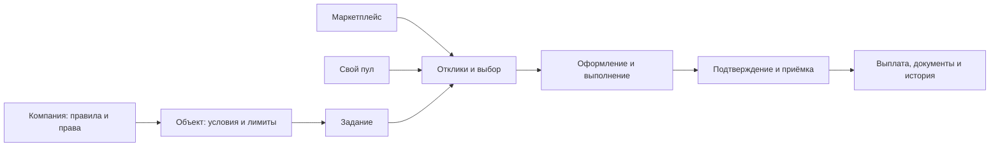

# WinWork: краткий контекст продукта

Рабочий срез: **16 ноября 2026 года**. Для первого знакомства достаточно этого файла; подробности загружайте по [карте функций](features.md). [Источники и границы достоверности](sources.md) объясняют, что подтверждено пользователем, что показано в прототипе, а что осталось историческим описанием или планом.

## Что это за продукт

WinWork — платформа для организации работы компаний с внештатными исполнителями. Она связывает поиск и подключение людей, задания и отклики, оформление документов, проверки, приёмку, выплаты, чеки и отчётность. Компания может работать со своим пулом и привлекать новых людей через открытый маркетплейс.

В материалах описаны самозанятые, ИП и физические лица в соответствующих сценариях. Налоговый статус, гражданство и вид договора — разные признаки: не нужно считать всех исполнителей самозанятыми или называть любой разовый заказ вакансией.

WinWork связан с ApiBank как продукт его портфеля; историческое название — «Мои самозанятые». Продукт, компания ApiBank, юридический оператор и банк расчётов — разные сущности. АО «Корса» указано оператором в сохранённых материалах и Court; текущие юридические сведения проверяют отдельно при необходимости. KDV Pay и другие продукты ApiBank не являются автоматически модулями WinWork.

## Для кого и через какой интерфейс

| Участник                            | Задача                                                                               | Поверхность                                                         |
| ----------------------------------- | ------------------------------------------------------------------------------------ | ------------------------------------------------------------------- |
| Компания-заказчик                   | Организовать работу и контролировать условия, людей, документы и расходы             | Веб-кабинет бизнеса                                                 |
| Администратор и сотрудники компании | Настроить виды работ, объекты, полномочия; выполнять разрешённые действия            | Тот же кабинет с ролевыми правами                                   |
| Руководитель объекта                | Создавать задания и работать с людьми на назначенных объектах                        | Отдельное мобильное приложение руководителя; доступ зависит от прав |
| Исполнитель                         | Найти задание, откликнуться, оформить участие, выполнить и получить выплату          | Приложение исполнителя; в некоторых сценариях веб-подключение       |
| Подрядчик                           | Работать с заказами клиентов, оформить отношения с исполнителем, подписать документы | Режим подрядчика в бизнес-кабинете                                  |
| API-клиент / партнёр                | Использовать процессы WinWork в своей системе                                        | API, иногда представление White Label                               |

Для крупного бизнеса особенно важны центральные правила и делегирование по сети объектов. Для малого — понятный короткий путь от задания до оплаты. Для компании со своим пулом — подключение людей без повторного ручного ввода. Для API-клиента — согласованное разделение процессов с собственной системой.

## Основная модель

Компания заранее задаёт виды деятельности, операции, требования, шаблоны документов и полномочия. Объект (магазин, склад и т. п.) ограничивает доступные работы, ставки и лимиты. Задание наследует эти настройки; руководитель действует в пределах назначенных объектов и выданных полномочий.

Проверки и ограничения применяются на разных этапах. Диаграмма показывает смысловую связь, не универсальную техническую машину состояний: порядок подписей и права зависят от конкретного сценария.

## Термины, которые нельзя смешивать

| Термин                              | Значение                                                                                                   |
| ----------------------------------- | ---------------------------------------------------------------------------------------------------------- |
| Объект                              | Место/операционная единица заказчика с условиями работы, руководителями и лимитами                         |
| Проект                              | Уровень организации работы/баланса в кабинете; связь с объектом зависит от версии и требует уточнения      |
| Вид деятельности / операция         | Тип работы и входящие в него действия; влияют на требования, стоимость и документы                         |
| Задание                             | Конкретная работа с местом, временем, объёмом и потребностью в исполнителях                                |
| Отклик / назначение                 | Заявка человека на участие / решение о выборе; это разные состояния                                        |
| Вакансия                            | Предложение трудоустройства, отличное от разового задания                                                  |
| Свой пул / предпочитаемые           | Подключённые исполнители / отдельный приоритет приглашения; собственный пул не делает маркетплейс закрытым |
| Заказчик / клиент                   | Одна сторона сделки; слово «клиент» используется в кабинете подрядчика                                     |
| Завершение / приёмка / оплата       | Сообщение о выполнении / принятие результата / расчёт; отдельные действия                                  |
| Договор / задание и акт / чек       | Разные документы; один не заменяет другой                                                                  |
| Реестр                              | Пакет данных определённого вида: объекты, исполнители, задания, документы, выплаты или отчётная таблица    |
| Лимиты объекта / лимиты исполнителя | Контроль расходов и работ на объекте / ограничения объёма работы конкретного человека с компанией          |
| НПД / ГПХ                           | Налоговый режим / формат договорных отношений, не взаимозаменяемые категории                               |

Просмотр, подпись и оплата — разные полномочия. Наличие кнопки в демонстрации не устанавливает универсальную роль HR или руководителя. Рейтинг, успешные задания, отзывы и допуск также не одна метрика.

## Подрядная схема и отчёты

В прямом сценарии компания работает с исполнителем непосредственно. В показанной подрядной схеме заказчик размещает задание и контролирует приёмку/момент оплаты, а договор с исполнителем заключает подрядчик. Исполнитель подтверждает выполнение, подрядчик подписывает документы, затем заказчик принимает и оплачивает. По пояснению пользователя выплата исполнителю идёт от юрлица подрядчика, а заказчик получает акт от подрядчика. Полное объяснение — [contracting.md](../contracting.md).

Отчёты дают заказчику сведения по подрядчикам, а подрядчику — по клиентам: реестр заданий или сводку компаний за выбранный период и статусы. Они не проводят платежи. Постановка, формулы прототипа и открытые вопросы — [reports.md](../reports.md).

## Что означает «реализовано»

В этом проекте реализованы локальные демонстрации и прототипы. Подробный каталог описывает более широкий продукт, но не доказывает выпуск каждой функции для каждого клиента. Маркетинговые утверждения, тарифы, финансовые показатели и нормативные пороги не становятся актуальными только потому, что присутствуют в старом файле.

Для новой задачи: выберите область в [features.md](features.md), прочитайте её актуальный тематический документ, затем нужные файлы из [agent-index](../agents/context-index.json). Контекст портфолио и история обсуждений объясняют смысл, а текущий код определяет поведение местного прототипа.
